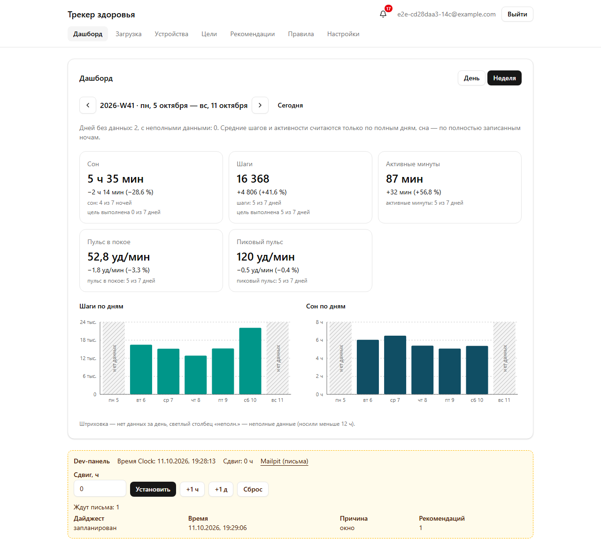

# Трекер здоровья (Health Tracker)

Веб-приложение собирает данные с часов и телефона (шаги, сон, пульс), объединяет их без двойного счёта,
считает дневные и недельные сводки, ведёт цели, выдаёт рекомендации по правилам R1–R6 и присылает их на почту
дайджестом не чаще раза в сутки с учётом тихих часов. Backend — Python (FastAPI) и PostgreSQL, frontend — React,
почта — Mailpit. Полное ТЗ — [`docs/SPEC.md`](docs/SPEC.md).



## Чем делали

Claude Code (десктоп-приложение Claude), модель Claude Opus 5.5 — ТЗ, план и почти все шаги. Почему: агент работает
с терминалом, git, Docker и браузером, поэтому можно было идти маленькими шагами с тестами до кода и сразу проверять
результат на живом стеке; Opus — сильнейшая модель для длинных многошаговых задач. Шаг 7.1 начал Codex (GPT-6), когда
закончился лимит Claude (ADR-042), довёл Claude Code. Шаги 8.3–12.1 сделаны с другого аккаунта Claude (тот же
инструмент и модель). Отдельная сессия Claude была консультантом: проверяла отчёты агентов и вручную проверяла работу
на живом стеке.

Как шла работа: [`docs/plan.md`](docs/plan.md) (шаги и их статус), [`docs/WORKLOG.md`](docs/WORKLOG.md) (журнал с
системным временем), [`docs/DECISIONS.md`](docs/DECISIONS.md) (ADR), [`docs/PROMPTS.md`](docs/PROMPTS.md) (указания
дословно), [`CLAUDE.md`](CLAUDE.md) (правила агента), экспорт сессий — [`docs/agent-session/`](docs/agent-session/).

## Состояние

MVP из SPEC §3.1 готов: все шаги плана 0.1–13.2 пройдены. 22 из 23 критериев готовности SPEC §9 — «работает»,
#3 — «частично»: случайные пропуски генератора (`--gap-prob`) закрывает второе устройство, и на дашборде их не видно.
Таблица «критерий → статус → чем доказано», известные проблемы и замеры — [`docs/STATUS.md`](docs/STATUS.md).

## Предварительные требования

- Docker Desktop (Windows, macOS) или Docker Engine с Compose v2 (Linux). Свободные порты 5173, 8000, 8025, 1025, 5433.
- Git.
- Для разработки и тестов без Docker: Python 3.12 и [`uv`](https://docs.astral.sh/uv/), Node.js 22 LTS.
- Windows: у каждого `scripts/*.sh` есть `scripts/*.ps1`; `.sh` хранятся с LF (`.gitattributes`).

## Запуск

```bash
git clone https://github.com/portosatos/main.git health-tracker
cd health-tracker
docker compose up --build
```

`.env` не обязателен: у всех настроек есть значения по умолчанию. Чтобы их поменять, скопируйте
`.env.example` в `.env` (`cp .env.example .env` или `Copy-Item .env.example .env` в PowerShell).

| Что | Адрес |
|---|---|
| Приложение (nginx, `/api` проксируется в api) | http://localhost:5173 |
| API и Swagger | http://localhost:8000/docs |
| Mailpit (письма) | http://localhost:8025 |
| PostgreSQL | `localhost:5433` |

Демо-пользователь создаётся при старте api: `demo@example.com` / `demo12345` (меняется через `DEMO_USER_*`
в `.env`). Все изменяющие запросы к API требуют заголовок `X-Requested-With: ht`; Swagger добавляет его сам.
Проверить, что стек работает: `scripts/smoke.ps1` (Windows) или `scripts/smoke.sh`.

## Демо

```bash
scripts/demo.sh
```

На Windows — `scripts/demo.ps1`. Скрипт поднимает стек (`docker compose up --build --wait`), генерирует месяц данных
в поясе демо-пользователя (с пропуском на весь день шесть дней назад и сценарием `short-sleep`), загружает файл и
открывает дашборд и Mailpit. Что посмотреть:

1. Войти `demo@example.com` / `demo12345` — дашборд за сегодня, переключатель «неделя»; день с пропуском — «нет данных».
2. «Рекомендации» — открыта R1 (короткий сон три ночи подряд); «Правила» — R1–R6 с порогами, их можно выключить.
3. Mailpit (http://localhost:8025) — дайджест приходит после окна (15 мин) вне тихих часов; очередь видна на
   dev-панели внизу страницы.
4. «Загрузка» — отчёт: новые, дубли, конфликты; повторная загрузка того же файла даёт 0 новых.
5. Dev-панель: сдвиг служебного времени (`Clock`) на сутки — новые срабатывания; после проверки — «Сброс».

`-Reset` / `--reset` сначала стирает все данные dev-стека (`docker compose down -v`), `-NoOpen` / `--no-open` — без
браузера. Свой файл: `uv run --project generator htgen --days 7 --seed 1 --out sample.ndjson`, затем
`scripts/upload.ps1 sample.ndjson`. Генератор умеет пропуски (`--gap`, `--gap-prob`), смену пояса (`--tz`,
`--tz-change`), сценарии правил (`--scenario short-sleep`, `sedentary`, `high-rhr`, `irregular`, `worse-week`,
`recovery`) и поток (`--stream`); формат — [`docs/DATA_FORMAT.md`](docs/DATA_FORMAT.md).

Скриншоты всех страниц при 1280 и 375 px — [`docs/screenshots/`](docs/screenshots/).

## Тесты

```bash
scripts/test.sh
```

На Windows — `scripts/test.ps1`. Скрипт поднимает PostgreSQL и Mailpit из compose и запускает pytest backend (unit и
integration, в том числе property-тесты Hypothesis), генератора и утилит `scripts/`. С e2e: `scripts/test.ps1 -All` /
`scripts/test.sh --all` — Playwright-сценарии 01–10 на отдельном стеке `health-tracker-e2e` (порты 5174, 8001, 8026,
5434; dev-стек при этом работает), только e2e — `scripts/e2e.ps1`.

- Frontend: `npm ci --prefix frontend` (один раз), затем `npm --prefix frontend run check` (typecheck, ESLint,
  Vitest, сборка).
- Линтер Python: `uv run --project backend ruff check .` и `uv run --project backend ruff format --check .`
- Замер большого файла (~200 МБ, около 5 мин): `scripts/bench_ingest.ps1`; проверка чистого клона:
  `scripts/fresh_clone_check.ps1`. Результаты пишутся в [`docs/STATUS.md`](docs/STATUS.md).
- Процесс и документы: `python scripts/check_process.py --all`, `python scripts/check_docs.py`.
- CI (`.github/workflows/ci.yml`) на каждый push в `main`: backend, генератор, frontend, e2e, LF у `*.sh`,
  `check_process` и `check_docs`.

## Документация

- [`docs/SPEC.md`](docs/SPEC.md) — техническое задание.
- [`docs/plan.md`](docs/plan.md) — план по шагам и их статус.
- [`docs/STATUS.md`](docs/STATUS.md) — статус критериев готовности, известные проблемы, замеры.
- [`docs/NEXT.md`](docs/NEXT.md) — что дальше.
- [`docs/API.md`](docs/API.md) — API: сводки, события, цели, правила, настройки.
- [`docs/DATA_FORMAT.md`](docs/DATA_FORMAT.md) — формат входных данных и генератор `htgen`.
- [`docs/MERGE_RULES.md`](docs/MERGE_RULES.md) — объединение устройств по минутам.
- [`docs/RULES.md`](docs/RULES.md) — правила R1–R6.
- [`docs/EMAIL.md`](docs/EMAIL.md) — дайджест и письма.
- [`docs/TIMEZONES.md`](docs/TIMEZONES.md) — часовые пояса и переезды.
- [`docs/WORKLOG.md`](docs/WORKLOG.md), [`docs/DECISIONS.md`](docs/DECISIONS.md), [`docs/PROMPTS.md`](docs/PROMPTS.md) —
  журнал работы, решения (ADR), указания заказчика.
- [`CLAUDE.md`](CLAUDE.md) — правила работы агента и все команды.

## Шаблоны и генераторы

Чужие шаблоны и генераторы кода, использованные в проекте:

- **Vite** (React + TypeScript) — скелет `frontend/` (сборка, dev-сервер, `tsconfig`), ADR-002, ADR-023.
- **shadcn/ui CLI** (`npx shadcn@latest init`, `add`) — сгенерированные компоненты `frontend/src/components/ui/`
  (button, card, input, label) и тема Tailwind; компоненты с `ref` переписаны на `forwardRef` (ADR-027).
- Генератор тестовых данных `htgen` (`generator/`) написан в проекте, не сторонний.

## Что дальше

Кандидаты на следующий заход — найденное по ходу работы (параллельные воркеры, видимые пропуски `--gap-prob`, запас
по времени обработки 200 МБ) и список «Потом» из SPEC §3.2: [`docs/NEXT.md`](docs/NEXT.md).
